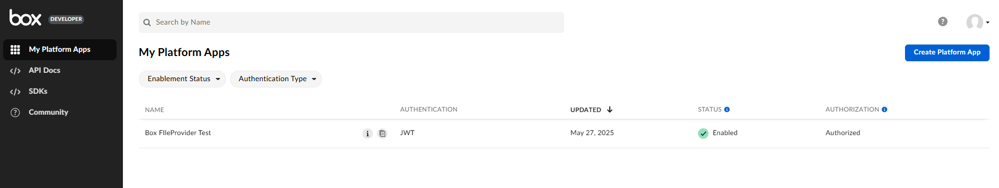
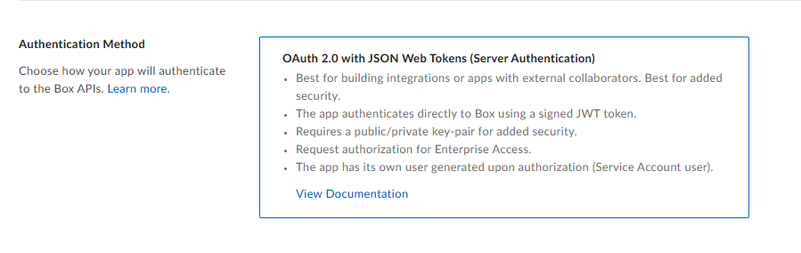
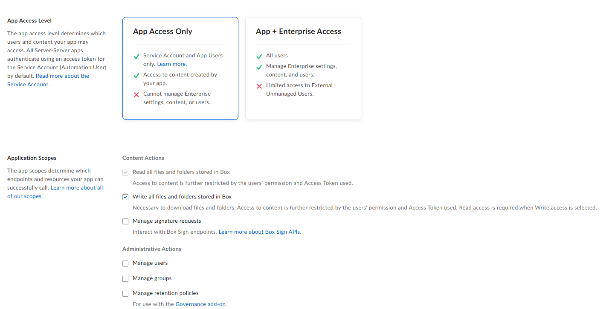
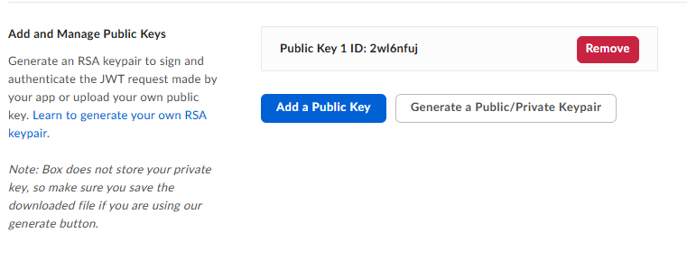

# Cloud File Storage Manager

Provides complete implementation to handle easily cloud file storage operations like get informations about files, reading, downloadURL generation, file update, file move and delete. Primarily for `Box` right now.

### Configuration

Let's add a section to the `appsettings.json`

```
"BoxStorageSettings": {
    "ClientId": "",
    "ClientSecret": "",
    "EnterpriseId": "",
    "PublicKeyId": "",
    "PrivateKey": "",
    "Passphrase": "",
    "RootFolderId": "0"
}
```
In the application, configure this settings part

```cs
services.AddSingleton<ICloudFileStorageManager, BoxCloudFileStorageManager>(services => new BoxCloudFileStorageManager(new BoxCloudFileStorageManagerOptions()
{
    ClientId = config.GetSection("BoxStorageSettings").GetValue<string>("ClientId"),
    ClientSecret = config.GetSection("BoxStorageSettings").GetValue<string>("ClientSecret"),
    EnterpriseId = config.GetSection("BoxStorageSettings").GetValue<string>("EnterpriseId"),
    PublicKeyId = config.GetSection("BoxStorageSettings").GetValue<string>("PublicKeyId"),
    PrivateKey = config.GetSection("BoxStorageSettings").GetValue<string>("PrivateKey"),
    Passphrase = config.GetSection("BoxStorageSettings").GetValue<string>("Passphrase"),
    RootFolderId = config.GetSection("BoxStorageSettings").GetValue<string>("RootFolderId")
}));

```

`PrivateKey` is the PEM private key from the Box config file. A key copied with escaped newlines (`\n` or `\r\n` written as text, as it appears in the downloaded JSON config file) is accepted and converted to real line breaks.

`RootFolderId` is the id of the Box folder that acts as the root of the storage; `"0"` (the default when it is not set) is the root of the service account.

## Behaviour

### Paths

Paths are relative to `RootFolderId` (and to `RootDirectoryPath`, when set). Both `/` and `\` separate segments, and name matching is case-insensitive.

A segment is rejected with an `ArgumentException` when it is empty or whitespace, consists only of dots and spaces, contains a control character, or does so after percent-decoding. A segment whose percent-decoded form contains `/` or `\` is rejected as well.

Zero segments address the root folder itself: `GetDirectoryContents()` lists the root folder. `ReadFile` and `GetDownloadUrl` need at least one segment.

### Root folder protection

The root folder (`RootFolderId`, or `RootDirectoryPath` when set) cannot be deleted, moved, renamed or overwritten. These calls throw an `InvalidOperationException`, also when a path resolves to the root folder by id.

### Uploads

- Files below 20 MB are uploaded in a single request, larger files with a Box chunked upload session.
- Non-seekable streams (for example a network or request stream) are first spooled to a temporary file, so the size is known and the content is not held in memory. The temporary file is deleted when the upload finishes or fails.
- `UpdateFileMode.Append` downloads the current content, combines it with the new content in a temporary file and uploads the result as a new version of the file.
- Missing parent folders are created on upload. When a path segment exists as a file, the upload fails with an `InvalidOperationException`.

### Listing and file information

- `GetDirectoryContents` pages through the folder and returns files and folders with their real sizes and modification times. Folders are reported with `Exists = true` and `IsDirectory = true`.
- The modification time is the Box `modified_at` value, falling back to `content_modified_at`.

### Reading

`ReadFile` downloads the file into a temporary file that is deleted when the returned stream is disposed. When the download fails, the temporary file is removed right away.

### Download links

`GetDownloadUrl` returns the temporary direct download link Box generates for the file. Box keeps the link valid for about 15 minutes; the validity argument is ignored. Folders have no download link and throw a `FileNotFoundException`.

### Not supported

`Watch` is not supported and throws a `NotSupportedException`.

## Images of the Box side configuration

Let's create a `Platform Application`



It is necessary to `Enable` the applicaiton and `Authorization` from administrators is required. After that, a service account is created for the Platform application with which the API interaction takes place.

`JWT` type application is recommended for this kind of use-cases



Minimal access is sufficient



Public/Private Keypair

A `Public/Private Keypair` is required for the necessary configuration, which can be created with the click of a button. A `config file` is also downloaded here, which contains all the necessary configuration data required for the configuration. (ClientId, Keys, etc.)



When using a Box Platform App with JWT authentication, your app acts as a service account, also called an App User. This service account is isolated from your personal Box account.

- Files and folders uploaded using JWT don't show up in "All Files" in your personal Box account — because they are not stored in your user’s root folder, but in the service account’s storage space.

Where did your files go?

If you're using JWT to authenticate via the platform app and then uploading files:
- The uploads are happening under the App User's account, not your personal Box user.
- Unless you explicitly upload to a folder owned/shared by a managed user (like yourself), it goes into the App User’s own root.
